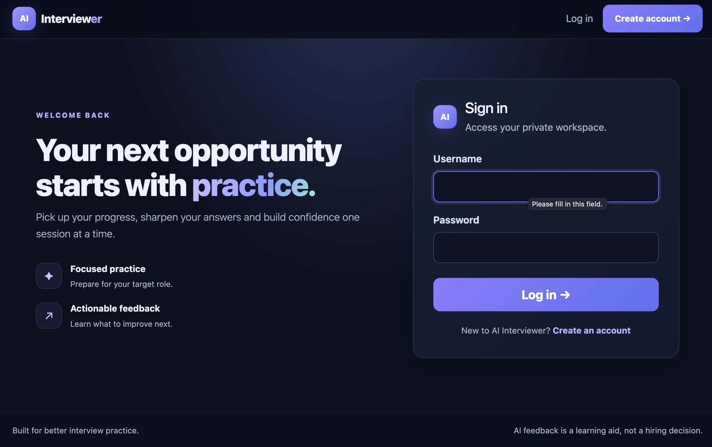
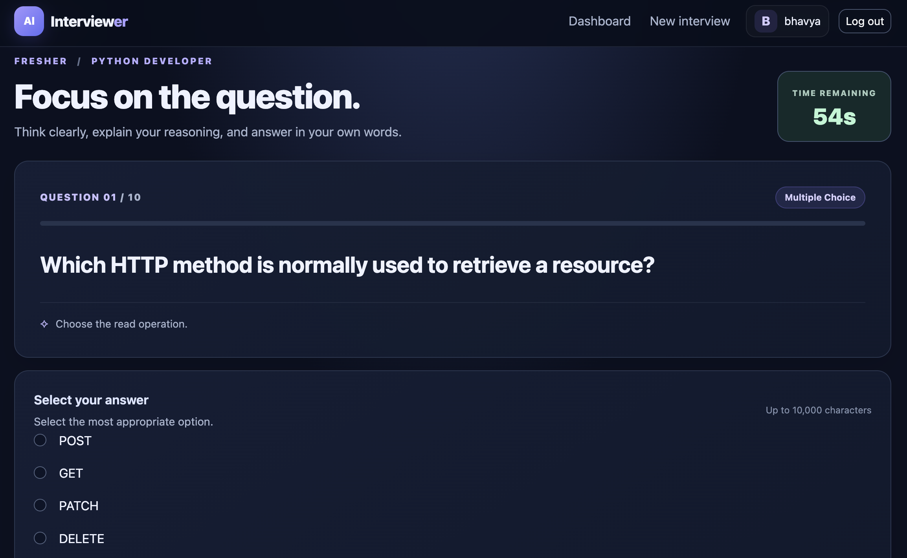
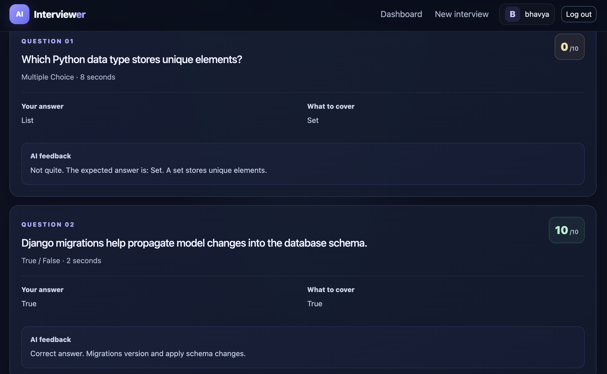
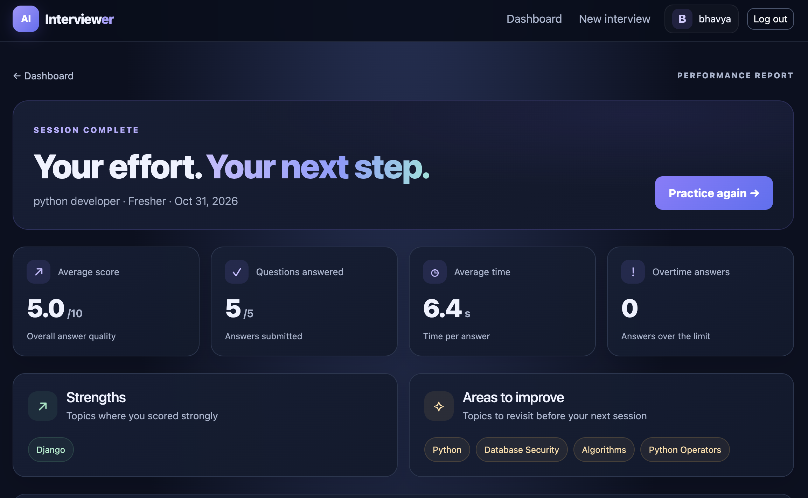
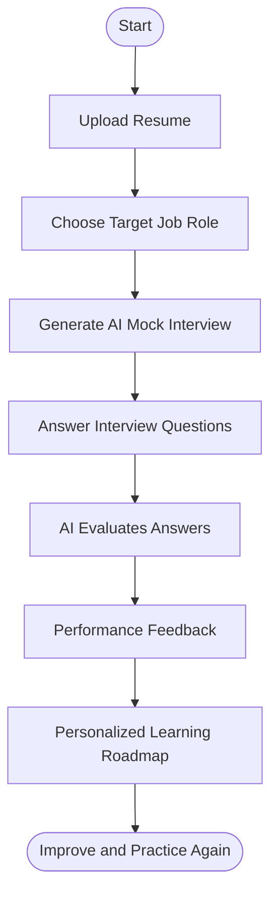

# 🚀 AI Interviewer

### Your Personal AI-Powered Interview Preparation Platform

**Upload Your Resume. Choose Your Role. Practice. Improve. Get Hired.**

An AI-powered mock interview platform built with **Python, Django, and Groq AI** that helps candidates prepare for interviews for any job role through resume uploads, AI-generated mock tests, personalized learning roadmaps, and intelligent performance feedback.

<p align="center">
  <a href="https://github.com/Bhavya7887/AI-Interview-Platform">
    
  </a>
  
  
  
</p>

---

## ✨ About The Project

Preparing for interviews can be difficult without proper guidance, realistic practice, and useful feedback.

**AI Interviewer** aims to make interview preparation smarter and more accessible.

Users can upload their resumes, select any target job role, practice AI-generated mock interviews, receive automated feedback, and follow personalized learning roadmaps to improve their interview performance.

The goal is simple: help candidates prepare with confidence.

---

## 🎯 Key Features

### 1. 📄 Resume Upload

- Upload your resume for interview preparation.
- Use your professional background as part of the interview workflow.
- Prepare for opportunities aligned with your target role.

### 2. 🤖 AI Mock Interviews — Any Role

- Generate dynamic interview questions using AI.
- Practice for different technical and non-technical job roles.
- Experience different question formats:
  - Multiple Choice Questions (MCQs)
  - True / False
  - Short Answer
  - Coding Questions
  - Debugging Questions
  - Scenario-Based Questions
- Practice with a timed interview experience.

### 3. 🗺️ Personalized Learning Roadmap

- Get a structured learning roadmap.
- Identify skills that need improvement.
- Follow learning tasks and exercises.
- Track your progress toward your target role.

### 4. 📊 AI Feedback & Performance Reports

- Receive automated AI-powered answer evaluation.
- Understand your strengths and weaknesses.
- Review interview scores and performance.
- Identify areas that need improvement.

---

## 🖥️ Application Preview


### Main Application




### AI Mock Interview



### Performance Feedback



### Personalized Learning Roadmap



---

## ⚙️ Technology Stack

| Technology | Purpose |
|---|---|
| Python | Backend programming |
| Django | Web application framework |
| Groq AI | AI-powered question generation and evaluation |
| SQLite | Database |
| HTML5 | Web structure |
| CSS3 | Styling and responsive UI |
| JavaScript | Interactive functionality |
| Git & GitHub | Version control |

---

## 🏗️ Project Architecture

```text
AI-Interview-Platform/
│
├── config/
│   └── Django project configuration
│
├── interviews/
│   ├── models.py
│   ├── views.py
│   ├── urls.py
│   └── ai_engine.py
│
├── templates/
│   └── Application templates
│
├── static/
│   └── CSS, JavaScript and static assets
│
├── media/
│   └── Uploaded files (local development)
│
├── manage.py
├── requirements.txt
└── README.md
```

---

## 🚀 Getting Started

Follow these steps to run the project locally.

### Prerequisites

- Python 3.x
- pip
- Git
- Groq API key

### 1. Clone the Repository

```bash
git clone https://github.com/Bhavya7887/AI-Interview-Platform.git

cd AI-Interview-Platform
```

### 2. Create a Virtual Environment

```bash
python3 -m venv .venv
```

### 3. Activate the Environment

**macOS / Linux**

```bash
source .venv/bin/activate
```

**Windows**

```bash
.venv\Scripts\activate
```

### 4. Install Dependencies

```bash
pip install -r requirements.txt
```

### 5. Configure Environment Variables

Create a `.env` file in the project root and configure your Groq API key.

```env
GROQ_API_KEY=your_groq_api_key_here
```

Get your API key from:

https://console.groq.com/

**Important:** Never commit your `.env` file or expose your API key publicly.

### 6. Apply Database Migrations

```bash
python manage.py makemigrations
python manage.py migrate
```

### 7. Create an Admin Account (Optional)

```bash
python manage.py createsuperuser
```

### 8. Run the Development Server

```bash
python manage.py runserver
```

Open your browser:

```text
http://127.0.0.1:8000/
```

---

## 🔄 How It Works



---

## 🎯 Project Goals

- Make interview preparation accessible to candidates across different job roles.
- Provide realistic AI-powered interview practice.
- Help candidates identify skill gaps.
- Provide actionable feedback.
- Support continuous learning and career development.

---

## 🔮 Future Improvements

- Advanced resume parsing and skill extraction.
- More personalized question difficulty.
- Improved performance analytics.
- Additional interview categories.
- Enhanced learning roadmap recommendations.

---

## 👨‍💻 Developer

**Bhavya Sandhu**

Computer Science Engineering Student | Aspiring Backend Developer

<p>
  <a href="https://github.com/Bhavya7887">
    
  </a>
  <a href="https://linkedin.com/in/bhavya-sandhu-049673324">
    
  </a>
</p>

---

## ⭐ Support

If you find this project interesting, consider giving the repository a star!

**AI Interviewer — Practice Smarter. Interview Better. Grow Faster.**